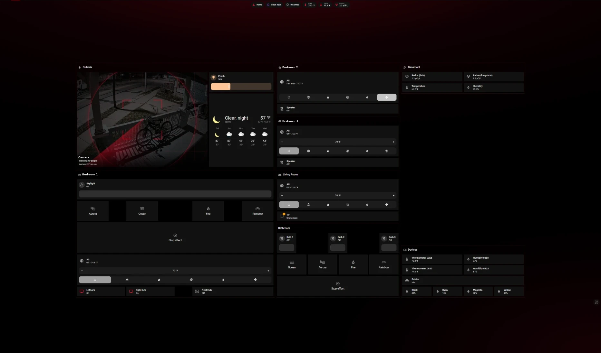

# Arrange Grid Card

A Home Assistant dashboard card that holds other cards on a grid you arrange by hand: drag a card to any cell, resize it by cells, leave cells empty, add or remove columns and rows. Each Home Assistant user keeps their own arrangement. On a narrow screen the cards are a list instead, with an order of its own.

It is meant to be the only card of a panel view, so it fills the page, but it works inside any view.



## Install

### With HACS

1. In HACS open the menu (three dots) and choose **Custom repositories**.
2. Add `https://github.com/OnticEntia/arrange-grid-card` with the type **Dashboard**.
3. Find **Arrange Grid Card** in HACS and download it.
4. Reload the browser. If the card is not offered in the card picker, add the resource yourself (**Settings → Dashboards → Resources**, type **JavaScript module**):

```
/hacsfiles/arrange-grid-card/arrange-grid-card.js
```

### By hand

1. Copy `dist/arrange-grid-card.js` into `<config>/www/` on your Home Assistant.
2. Add it as a dashboard resource of type **JavaScript module**:

```
/local/arrange-grid-card.js?v=1
```

Raise the number after `v=` every time you replace the file, otherwise browsers and the companion app keep the old copy.

The browser console shows `ARRANGE-GRID-CARD v…` once when the card has loaded.

## Use

Add the card, from the card picker ("Arrange Grid") or in YAML:

```yaml
type: custom:arrange-grid-card
layout: home
columns: 24
cards:
  - id: porch
    type: tile
    entity: light.porch
  - id: forecast
    type: weather-forecast
    entity: weather.home
```

Give every card an `id`. A saved place is kept under it, so cards can be added, removed and reordered in the config without anything else moving. A card without one is known by its position in the list (`#0`, `#1`, ...), and its saved place then follows the position, not the card. The visual editor gives an id to every card it adds or moves.

## Options

| Option | Default | Meaning |
| --- | --- | --- |
| `cards` | required | The cards, as in a stack card. Any card type. `id` on a card is this card's own key and is not passed on to it. |
| `columns` | `12` | Columns of the grid while nobody has arranged it. An arrangement keeps its own column count (changed in Arrange mode). 1 to 48. |
| `row_height` | `56` | Pixels. The least height of a row; 56 with a gap of 8 is what a sections view uses. |
| `gap` | `8` | Pixels between cells. |
| `min_width` | `600` | Pixels. When the card itself is narrower than this, the cards are a list. `0` never. |
| `storage` | `user` | `user`: each Home Assistant user arranges their own. `config`: one arrangement for everyone, kept in this card's config in the dashboard. |
| `layout` | the page's path | The name the arrangement is kept under. Set it when two of these cards are on one page, or to share one arrangement between pages. |
| `default_layout` | none | The arrangement everyone starts from (see below). |
| `badges` | none | Badges shown in a centred row over the grid, written as a view's `badges` are (an entity id, or a badge's config). A panel view has no badges of its own. Set in YAML. |
| `title`, `icon` | none | A title bar over the cards. Meant for a group (this card inside another, see Groups). |
| `arrange_button` | `true` | The round button under the grid that opens the menu. |
| `groups` | `true` | A `heading` card and the cards after it, up to the next heading, are a group (see Groups). `false` turns that off. |
| `hide_add_menu` | `false` | `true` hides the add menu in Home Assistant's dashboard header (add device, create automation, create area, add person) while this card is on screen. Those add nothing to this page; cards and groups are added from the card's own menu and editor. |
| `context_menu` | `true` | `false` leaves right-click and long press alone; the button is then the only way in. |

Styling: `--arrange-grid-padding` (default `8px`) is the space around the grid. Everything else follows the theme's variables.

## Arranging

Open the menu with the button under the grid, a right-click anywhere on the page, or a long press on an empty part of it. A long press on a card is left to the card (its hold action).

- **Arrange…** On a wide screen: drag a card to any cell (with a mouse from anywhere on it, with a finger by the grip in its corner, so the page still scrolls). Dropped on another card, the two change places if both fit. Drag the handle in the other corner to resize. A card never overlaps another and never leaves the grid; when something cannot be done, the bar says why. `Columns` and `Rows` add or remove one; the last one goes only when it is empty. While a card is being dragged, the grid under the pointer (the page, or the group it is over) shows an empty row under its last card to drop into; everything else, and all of it the rest of the time, is shown at its real size. A row added with `Rows` stays until Done; empty rows at the bottom are not saved. Holding a card near the top or bottom of the window scrolls the page.
- With the keyboard: Tab to a card, arrow keys move it one cell, Shift and arrow keys resize it, Esc cancels.
- **The bin.** While a card is dragged, a bin shows at the bottom of the window; dropping the card there removes it. With the keyboard, Delete does the same. A selected group goes as one. For an administrator, on a dashboard edited in Home Assistant's UI, removing is **deleting**: when Done is pressed the card leaves the dashboard's config, for everyone, and Reset layout has nothing to bring back. For anyone else (or a YAML dashboard) it is hiding: the user's own, and **Show a hidden card…** brings it back. Either way nothing happens before Done: Cancel brings everything back, and Undo takes it back.
- **Undo** and **Redo** in the bar (Ctrl+Z, and Ctrl+Shift+Z or Ctrl+Y; Cmd on a Mac) step back and forth through everything done in this Arrange: moves, resizes, columns and rows, a new order, cards dropped on the bin, whichever grid of the page it was in. Up to 50 steps. A card that changed groups, or a card or group that was added, is taken back too (the dashboard is changed back, which redraws the page, and Arrange goes on); such a step is not done again by Redo.
- **Done** saves, **Cancel** (or Esc) drops the changes.
- **Reset…** stands apart from those two and asks first, saying what goes and for whom. It goes back to the default arrangement, for the page and every group in it. What was on screen is kept as a previous arrangement, and **Undo reset** is offered right after.
- **Hide a card… / Show a hidden card…** A hidden card is taken off the page, so it loads and plays nothing, and keeps its place for when it is shown again.
- **Edit this card…** (right-click on a card, also while arranging; without a right-click, **Edit a card…** in the page's menu lists them) opens Home Assistant's own edit-card dialog for that card: its visual editor where it has one, YAML otherwise, with the preview. Saving writes the card back into the dashboard at its place, on the page or in its group; its `id` stays, so its place in the arrangement does too. On a group it is **Edit this group…** (title, icon and its cards). For an administrator, on a dashboard edited in Home Assistant's UI. While arranging, saving keeps what was arranged so far and Arrange goes on after the redraw; the edit itself is not a step Undo or Cancel takes back. Home Assistant has no public way to open that dialog from a card: this asks for it the way the frontend's own view does (a `show-dialog` event for `hui-dialog-edit-card` with a `saveCardConfig`, the dialog's loader taken from the view's answer to `ll-edit-card`), which a frontend update can break. When it cannot be opened the card says so, and the card can still be edited in the grid card's own editor.
- **Reset layout…** forgets everything of the user's own: places, sizes, the list's order, what is hidden and what is folded. It asks first, and on a page with groups asks whether the groups go too. With `storage: config` it says that the arrangement is removed for everyone.
- **Restore a previous arrangement…** Before an arrangement is reset, restored, or changed by an Arrange, what it was is kept: the last five for each page. Picking one brings it back for every grid it was kept for (what it replaces is kept in its turn, so restoring can be taken back as well). They are kept with the user's own data in Home Assistant, so they are there after a reload and on another device.

On a narrow screen Arrange only changes the order, with each card's arrows or by dragging its grip onto another card. Each card also has a bin button (and the bin shows while dragging); on a group's heading it removes the whole group. That order is saved apart from the wide grid: neither changes the other, and Reset only resets the one on screen. Until an order is made, the list follows the wide grid row by row.

## Groups

A group is a box with a title that holds cards of its own. It is this same card, used as one of the cards of another:

```yaml
type: custom:arrange-grid-card
layout: home
columns: 48
cards:
  - id: lights
    type: custom:arrange-grid-card
    title: Lights
    icon: mdi:lightbulb
    cards:
      - id: bedroom
        type: custom:arrange-grid-card
        title: Bedroom
        cards:
          - id: lamp
            type: tile
            entity: light.lamp
```

- **One Arrange for everything.** Arrange on the page opens the page and every group in it at once, to any depth: any card can be dragged, resized or dropped on the bin where it is, without opening its group first. There is one bar; Undo, Redo, Done, Cancel and Reset are for all of it. A group nobody touched keeps no arrangement of its own.
- **Right-click while arranging** opens a short menu for what is under the pointer. On a group's title bar (or an empty part inside the group): one column or row more or fewer for the group's own grid, **Fit the group's height to its cards**, **Add group inside…**, and removing it. On an empty part of the page: the page's columns and rows, and **Add group…**. On a card: removing it. A group added while arranging is written into the dashboard at once (what was arranged so far is kept, the page is redrawn and Arrange goes on); Cancel takes it away again.
- **Done fits every group's height to its cards**: shorter always, taller where there is room under it (otherwise its rows stretch, as for any card taller than its cells).
- **A group is one card of the grid it is in.** While arranging, its title bar is its handle (drag it to move the group with everything in it) and its corner resizes it; the bin removes the whole group. With nothing arranged it is as wide as a section and as tall as what is in it.
- **Inside, it has its own grid** (12 columns unless `columns` says otherwise, so cards sit as they would in a section) and its own arrangement, kept under `<the outer name>/<its id>`. Right-click in the group, or long-press an empty part of it, for the group's menu: **Arrange inside this group…** (only this group, with its own Columns and Rows), **Hide this group**, **Arrange the whole page…**.
- **In the list a group folds shut** by its title bar, leaving only the title. What is folded is kept per user (with `storage: config`, per browser).
- **Groups hold groups**, to any depth: "Lights" can hold a group for each room.
- A group takes `row_height`, `gap`, `storage` and `context_menu` from the card it is in unless it sets its own, shows no arrange button unless `arrange_button: true`, and is a grid or a list as the outer card is.
- **Adding a card:** the page's menu has **Add card…** (a group's menu **Add card here…**): type part of an entity's name or id, pick it, and a `tile` card for it is written into the dashboard there. For any other card type or options, use the card's editor. The same items are in the right-click menu while arranging.
- **Adding one:** the page's menu has **Add group…** (and a group's menu **Add group inside…**): type a title and the empty group is written into the dashboard, ready to be filled with **Move to…** or by dragging. Like moving a card, this is for an administrator on a dashboard edited in Home Assistant's UI. The editor's **Add group** does the same from the card's editor; editing a group there opens this same editor for the group's own cards.
- **Moving a card to another group: drop it there.** While arranging, a card dragged over another group (or out of its own, onto the page) lights that group up and the bar says where it would go. Dropped, it becomes one of that group's cards, at the cell it was dropped on (the next free one if that is taken); in the list, at the row it was dropped on. "In a group" means inside the group's box; the innermost box under the pointer wins.
- **What a drop does.** Which group a card is in is the dashboard's config, so the drop rewrites the dashboard: for everyone, only by an administrator, and only on a dashboard edited in Home Assistant's UI (not YAML). Everything arranged so far is kept first, as Done would; Home Assistant then redraws the page and Arrange opens again by itself. **Cancel still takes it all back**: the cards return to their groups and every arrangement to what it was when Arrange was opened. Done makes it stay.
- A card's menu also has **Move to…**, which lists the page and every group; a group's own menu has **Move this group to…**. A group itself changes groups by the menu only, so that dragging groups about never nests them by accident.

### Headings as groups

The lighter way, for a flat page: a `heading` card starts a group: the cards after it in the config, up to the next heading, belong to it. Nothing else has to be set.

- **On a wide screen, in Arrange:** a group's heading has a button beside its grip. Press it to select the group; then dragging any of its cards, or moving one with the arrow keys, moves the heading and all its cards together, keeping their places relative to one another. The group goes only where all of it has room; it does not swap with other cards. Press the button again to move cards one by one. Resizing is always one card at a time.
- **In the list:** each group's heading has a button at its right end that folds the group shut, leaving only the heading. What is folded is kept per user (with `storage: config`, per browser). Folded cards stay loaded, so opening a group is instant.
- **Hiding:** the menu of any card in a group also has **Hide this group**, which hides the heading and all its cards at once. Showing a hidden heading again brings back the hidden cards under it.
- **Removing:** in the editor, a heading with cards under it has a second remove button that takes the whole group out of the config.
- **Ordering the list:** moving a heading takes its cards along as one block, and its arrows step over a whole neighbouring group at a time. Other cards move one place at a time, as before.

## Sizes

- **With nothing arranged**, cards follow one another in the config's order. Each takes the size it asks for: `grid_options` in its config (`columns` out of 12, `rows`), else what the card itself reports, else the full width of a section and a height from its card size. A sections view's section, 12 of those columns, is taken as a quarter of the grid's columns.
- **In the list**, a card is as wide as its `columns` out of 12, exactly as in one section of a sections view: two 6-column tiles sit side by side, four 3-column buttons share a row.
- **Children are told they are in a grid** (`layout = "grid"`, as a sections view does), so cards that support it fill the cells they are given.
- **Opening Arrange gives every card the rows it needs.** A card that was shorter than its content (its rows were stretched to hold it, leaving gaps in its neighbours) is made as tall as it needs, and what is under it moves down. The same for a group that outgrew its box. Cancel puts it all back.
- **A card cannot be sized shorter than its content.** In Arrange, resizing stops at the height the card needs at its width (a group knows it from its cards; any other card is measured on screen), and the bar says so. Shorter than that, its rows would stretch and everything else in those rows with them.
- **A card taller than its cells makes its rows taller.** Rows are at least `row_height` and grow with their content; nothing scrolls inside a cell and nothing is cut off. The other choice, a scrollbar inside the cell, traps the finger on a phone and hides content behind a second scroll on a page that already scrolls. The cost is that rows are not all the same height once a card outgrows its cells; giving that card more rows in Arrange evens it out.

## Where the arrangement is kept

- `storage: user`: in Home Assistant's per-user frontend data (key `arrange_grid_card`, one entry per `layout` name), so it follows the user across browsers and the companion app. The browser keeps a copy (`localStorage`, `arrange-grid-card:layout:<name>`) that is shown at once on load; if Home Assistant does not take a save, the copy is marked and sent again on the next load. The previous arrangements are beside them, under `previous` in the same key: for each page (the outermost card's `layout` name) up to five of `{at, why, layouts, defaults}`, the newest first, where `at` is a time in milliseconds, `why` is `reset`, `arrange` or `restore`, `layouts` holds the user's own arrangement of each grid by `layout` name (`null`: it had none), and `defaults` those kept in the dashboard with `storage: config`. The browser keeps a copy of these too (`arrange-grid-card:previous:<name>`), used when Home Assistant did not take them.
- `default_layout` in the config is what a user sees until they make their own, piece by piece: their grid, their list order and their hidden cards each replace the default's. To ship one: arrange the page yourself, open the card's editor and press **Use my arrangement as the default** (it asks before replacing a default that is already there, as **Remove the default…** asks before removing it). By hand it looks like this (columns and rows count from 0):

```yaml
default_layout:
  grid: { cols: 24, rows: 6 }
  tiles:
    - { id: porch, c: 0, r: 0, w: 6, h: 1 }
    - { id: forecast, c: 6, r: 0, w: 12, h: 4 }
  list: [forecast, porch]   # optional: the order of the narrow list
  hidden: []                # optional
```

- `storage: config`: nothing per user. Done writes `default_layout` into this card in the dashboard (the same call the dashboard editor uses), so everyone gets it. Only administrators can arrange then, the dashboard must be one managed in the UI (not YAML), and Home Assistant redraws the view after the save, which restarts the cards on it. When the save cannot be made, the layout is shown as text to paste into the config.
- A saved card that is no longer in the config leaves its cells empty. A card that is new, or saved somewhere it cannot be, takes the first free place at its own size.

## Editor

The visual editor lists the cards (add with Home Assistant's card picker, edit with each card's own editor or as YAML, move, remove), the grid options, and the default arrangement. Moving or removing cards that have no `id` gives the remaining ones an id first; places saved under their old position keys (`#0`, ...) are not carried over, which is one more reason to set ids from the start.

## Known limits

- `visibility` conditions on a child are not applied: the children are created with Home Assistant's card helpers, and conditions are handled by a wrapper those do not include. Use a `conditional` card as the child instead.
- The editor borrows Home Assistant's card picker and card editor (`hui-card-picker`, `hui-card-element-editor`), which are loaded by asking for the stack card's editor. If a release changes that, cards are still editable: the config is shown as JSON text instead. Written against Home Assistant 2026.11.
- A panel view shows no badges; use this card's `badges` option, or a `heading` card's.
- Two of these cards on one page need different `layout` names (cards added from the picker get one).
- With `storage: config`, an arrangement made inside a group cannot be written to the dashboard by the card: it is shown as text to paste into the group's `default_layout`.
- A group's height in the outer grid follows its cards when Done is pressed in Arrange (or by the menu's **Fit the group's height to its cards**), not at other times.
- The menu while arranging takes a right-click, so it is not to be had on a touch screen; there, **Arrange inside this group…** shows the group's Columns and Rows in the bar.
- `hide_add_menu` reaches into Home Assistant's header to hide one button. If a release moves that button the option stops working, and nothing else breaks. On a narrow screen the same entries sit in the header's overflow menu, which is left alone.
- The menu takes over right-click on the page, except in text fields. Set `context_menu: false` to keep the browser's menu.

## Layout

- `dist/arrange-grid-card.js`: the card and its editor in one file, written by hand: no build step, no dependencies. This is the file HACS installs.
- `hacs.json`: what HACS needs to know.
- `.github/workflows/validate.yml`: HACS's validation and the tests, on every push and pull request.
- `tests/`: `node:test` tests with stand-ins for the browser and for Home Assistant (`tests/dom.js`). No packages to install.

```bash
node --test tests/
```

```bash
node --check dist/arrange-grid-card.js
```

The arranging model (cells and places, Arrange mode, the one-column list, the menu, per-user storage with a browser copy) was copied from the camera wall card in [protect-detections](https://github.com/OnticEntia/protect-detections) and made general. The two files share no code at run time; a fix in one has to be carried to the other by hand.

## Status

Version 0.15.0. The tests cover the grid maths, building and keeping the child cards, arranging by pointer and keyboard, both storage modes, undo and redo, reset and the previous arrangements, the menu and the editor, all against stand-ins. Rendering was checked in Firefox with placeholder cards; it has had little use inside Home Assistant yet, so expect rough edges and please report them.

## Licence

MIT, see [LICENSE](LICENSE).
